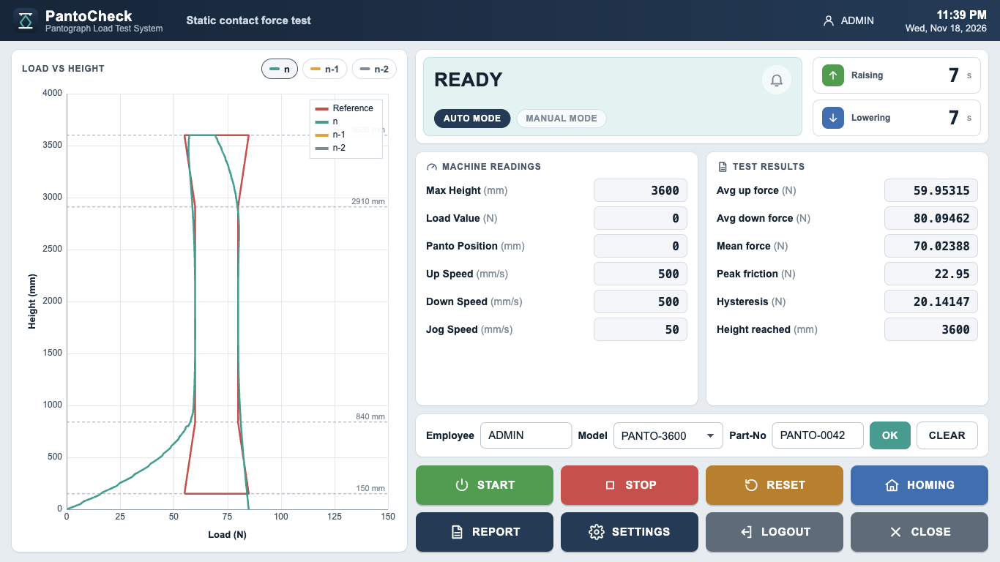
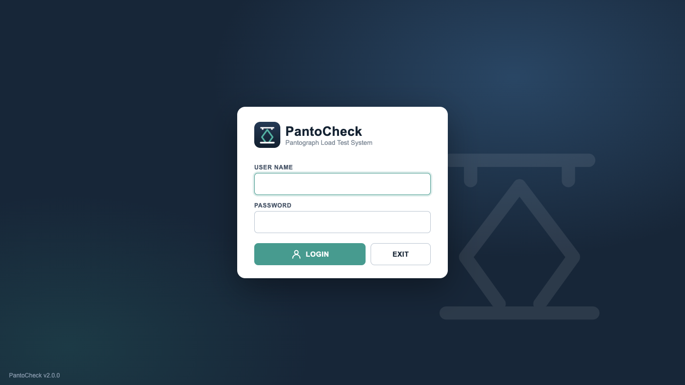
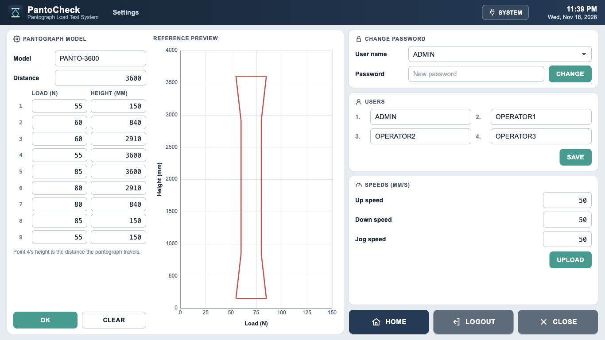

# PantoCheck

Operator software for **pantograph load testing machines**. It runs on the machine's Windows touchscreen PC, talks to the machine's **Siemens S7 PLC over Ethernet** (or a Modbus PLC), plots load against height live during a test, computes the static contact force results and saves an Excel, PDF and JSON report for every test.

### ⬇ [Download the Windows installer](https://github.com/Aashish3071/pltm-hmi/releases/latest)

> The green **Code → Download ZIP** button gives the *source code only* — it does not contain the installer. Use the link above, then click the `.exe` under **Assets**.



## Download and install (Windows)

1. Open the **[latest Release](https://github.com/Aashish3071/pltm-hmi/releases/latest)** and, under **Assets**, download `PantoCheck-Setup-<version>.exe`. Download it directly on the Windows PC: sending the `.exe` by chat or email can corrupt or block it.
2. Run it on the Windows PC. If Windows shows *"Windows protected your PC"*, click **More info → Run anyway** (the installer is not code-signed).
3. Start **PantoCheck** from the desktop shortcut and log in as `ADMIN` / `1234` (operators: `OPERATOR1`–`3` / `123`).
4. Open **SETTINGS** (administrator sign-in) and change all four passwords before anyone else uses it.

| Requirement | |
| --- | --- |
| Windows | 10 or 11, 64-bit |
| Other software | None. The installer contains everything (Microsoft Excel is not needed for reports) |
| Admin rights | Not needed. It installs for the current Windows user |

Each release is built and tested on Windows by GitHub Actions ([workflow](.github/workflows/windows.yml)).

## Features

- **Home**: live status (READY, PANTO RAISING, HALT, faults…) with an alarm indicator, AUTO / MANUAL mode, raising and lowering cycle times, machine readings (max height, load, position, up / down / jog speed) and the load–height graph with the model's reference envelope and the last three tests (n, n-1, n-2).
- **Results**: average up and down force, mean force, peak friction, hysteresis and height reached.
- **Operation**: Employee, Model and Part-No with OK / CLEAR; START, STOP (becomes RESUME while paused), RESET, HOMING, REPORT, SETTINGS, LOGOUT, CLOSE.
- **Settings** (administrator only): pantograph models (name and 9 load/height points; point 4 is the travel distance), user names, passwords, and up / down / jog speeds (UPLOAD sends them to the PLC).
- **Reports**: one A4 test report per test as **Excel**, **PDF** and **JSON** (with every recorded sample), named after the model, part number and time.
- **History**: search past tests by Part-No, model and date, see each test's graph and results, and reprint its report.
- **Backups** (SETTINGS → DATA): a daily automatic backup of users, models, settings and test records, to a folder of your choice (e.g. a USB stick); restore from any backup. A damaged database is detected at start-up and the newest good backup is offered.
- **Forgotten ADMIN password**: *Forgot ADMIN password?* on the login screen shows a request code; support answers with a response code (`npm run recovery-code`) that lets the ADMIN password be reset.
- **Machine connection**: **Siemens S7** over Ethernet, the **PantoCheck controller** (our Arduino firmware in [`firmware/`](firmware/README.md), Modbus RTU), any other **Modbus** PLC (RTU on a USB-to-RS485 COM port, RTU over TCP or Modbus TCP), plus a built-in **simulator**. Reconnects by itself and shows ETHERNET DISCONNECTED meanwhile.
- **Users**: four accounts; passwords stored hashed.

| Login | Settings |
| --- | --- |
|  |  |

## Connecting to the machine

Connection settings are under **SETTINGS → SYSTEM** (administrator only).

| Machine | Hardware | Driver |
| --- | --- | --- |
| Siemens PLC | Ethernet cable to the PLC; PC on the PLC's network (e.g. `192.168.0.x`) | Siemens S7 — IP, rack, slot and data block addresses |
| PantoCheck controller (Arduino) | USB, or a USB-to-RS485 adapter on the machine ([firmware/README.md](firmware/README.md)) | PantoCheck controller — COM port, 9600 baud, slave 1 |
| Modbus PLC, USB-to-RS485 adapter | Adapter driver (FTDI, CH340 or CP210x) so it appears as a COM port | Modbus RTU, COM port |
| Modbus PLC behind an Ethernet gateway | PC on the gateway's address range | Modbus RTU over TCP, or Modbus TCP |

**TEST CONNECTION** only reads from the machine, so it is safe for checking addresses. The PLC interface, status codes, result formulas and the commissioning checklist are in [docs/plc-interface.md](docs/plc-interface.md).

## Where data is stored (Windows)

| What | Location |
| --- | --- |
| Users, models, settings, test history | `%APPDATA%\PantoCheck\pltm.db` |
| Log file | `%APPDATA%\PantoCheck\logs\pltm.log` |
| Reports (.xlsx, .pdf, .json) | `Documents\PantoCheck Reports` (changeable under SETTINGS → SYSTEM) |
| Backups | `Documents\PantoCheck Backups` (changeable under SETTINGS → DATA) |

---

## Development

Built with Electron, React and TypeScript ([electron-vite](https://electron-vite.org)), SQLite ([better-sqlite3](https://github.com/WiseLibs/better-sqlite3)), a built-in Siemens S7 client (`src/main/hardware/s7`), [modbus-serial](https://github.com/yaacov/node-modbus-serial) and [serialport](https://serialport.io), [ExcelJS](https://github.com/exceljs/exceljs) for reports, packaged with [electron-builder](https://www.electron.build).

```bash
npm install
npm run dev          # run the app with hot reload
```

### Tests

```bash
npm test             # all suites below
npm run typecheck
npm run test:machine # result maths; S7 driver vs a fake S7 PLC; Modbus RTU/TCP; simulator; reports
npm run test:serial  # Modbus driver over a virtual COM port (needs socat: brew install socat)
npm run test:firmware # controller firmware compiled for the PC, driven by the app's controller driver (needs g++ or clang++)
npm run test:e2e     # clicks through the built app against a fake S7 PLC; screenshots in scripts/out/e2e
```

The serial and firmware suites are skipped automatically where `socat` or a C++ compiler is not available (e.g. Windows).

### Admin password recovery codes

Release builds need the `PLTM_RECOVERY_SECRET` repository secret (Settings → Secrets and variables → Actions); the release workflow refuses to build without it. To answer a customer's request code:

```bash
PLTM_RECOVERY_SECRET=... npm run recovery-code -- <request code> <machine ID>
```

### Building the Windows installer

```bash
npm run dist:win     # -> dist/PantoCheck-Setup-<version>.exe
```

Works on Windows and macOS. On Apple Silicon Macs without Rosetta, install a native NSIS first (`brew install makensis`); the build script uses it automatically.

### Publishing a release

Bump `version` in `package.json`, commit, then push a tag:

```bash
git tag v2.0.0 && git push origin v2.0.0
```

GitHub Actions runs the tests on Windows, builds the installer there and attaches it to a new Release.

### Project layout

| Path | Contents |
| --- | --- |
| `src/main/` | Electron main process: database, services, IPC handlers |
| `src/main/hardware/` | Hardware layer: `HardwareManager` (driver hub, reconnect), `S7Hardware` + `s7/S7Client`, `ModbusHardware`, `MockHardware` and `PlcEmulator` (simulator), config validation |
| `src/preload/` | The typed `window.pltm` API exposed to the UI |
| `src/renderer/` | React UI: Login, Home, Settings screens and dialogs |
| `src/shared/` | Types, status codes, IPC channel names, product name (`brand.ts`), filter and result formulas (`analysis.ts`) |
| `scripts/` | Test suites, fake S7 and Modbus PLCs, icon generator, build hooks |
| `resources/` | App icon (`icon.png`, `icon.ico`) |
