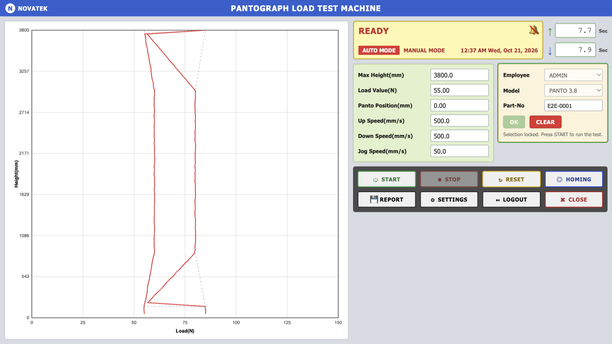
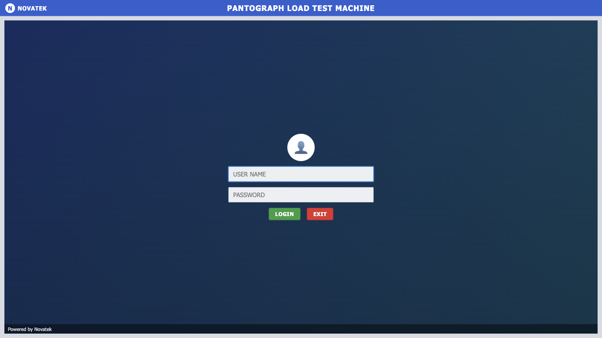
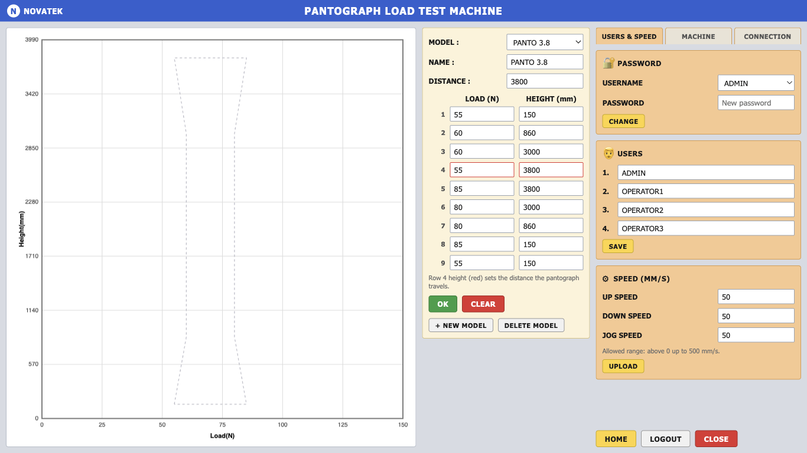

# PLTM HMI

Operator software for Novatek's **Pantograph Load Testing Machine** (PLTM). It runs on the machine's Windows touchscreen PC, talks to the PLTM Control Box over **Modbus RTU**, plots load against height live during a test, and saves an Excel report for every test. It replaces the original `Main_Gui.exe` and follows the same screens and workflow as the machine's user manual.

### ⬇ [Download the Windows installer (PLTM-HMI-Setup.exe)](https://github.com/Aashish3071/pltm-hmi/releases/latest)

> The green **Code → Download ZIP** button gives the *source code only* — it does not contain the installer. Use the link above, then click the `.exe` under **Assets**.



## Download and install (Windows)

1. Open the **[latest Release](https://github.com/Aashish3071/pltm-hmi/releases/latest)** and, under **Assets**, download `PLTM-HMI-Setup-<version>.exe`. Download it directly on the Windows PC: sending the `.exe` by chat or email can corrupt or block it.
2. Run it on the Windows PC. If Windows shows *"Windows protected your PC"*, click **More info → Run anyway** (the installer is not code-signed).
3. Start **PLTM HMI** from the desktop shortcut and log in as `ADMIN` / `admin`.
4. Open **SETTINGS** and change all four passwords before anyone else uses it.

| Requirement | |
| --- | --- |
| Windows | 10 or 11, 64-bit |
| Other software | None. The installer contains everything |
| Admin rights | Not needed. It installs for the current Windows user |

Each release is built and tested on Windows by GitHub Actions ([workflow](.github/workflows/windows.yml)).

## Features

- **Login and users**: four accounts (ADMIN, OPERATOR1-3), passwords stored hashed. Settings need the admin password.
- **Live test screen**: load (N) vs height (mm) graph over the model's profile, status bar, live readings, up/down cycle timers.
- **Operating buttons** as in the original HMI: START, STOP / RESUME, RESET, HOMING, REPORT, SETTINGS, LOGOUT, CLOSE.
- **Models**: create, edit and delete test profiles of 9 load/height points; row 4's height is the travel distance.
- **Excel reports**: one `.xlsx` per test with the run details, model profile, every recorded reading and the graph.
- **Machine connection** over Modbus RTU through a USB-to-RS485 adapter (COM port) or an Ethernet gateway (RTU over TCP, or Modbus TCP). Addresses come from an editable register map, so commissioning needs no code changes.
- **Simulator** built in, for training and for running without the machine.
- **Safety**: software overload trip, HOMING and START guard rails, hold-to-run jog that stops within 0.6 s if the hold is lost, automatic reconnection, and tests cut short by a disconnect or power loss are recorded as such.

| Login | Settings |
| --- | --- |
|  |  |

## Connecting to the machine

Connection settings are in **SETTINGS → CONNECTION** (admin only).

| Connection | Hardware | PROTOCOL setting |
| --- | --- | --- |
| USB-to-RS485 adapter | Adapter driver (FTDI, CH340 or CP210x) so it appears as a COM port | Modbus RTU, serial COM port |
| Ethernet gateway, transparent mode | PC on the gateway's address range, e.g. `192.168.0.x` | Modbus RTU over TCP (gateway) |
| Ethernet gateway, Modbus TCP mode | PC on the gateway's address range | Modbus TCP |

> **The register map shipped with the software is a placeholder.** Enter the real PLC addresses from the PLC programmer before switching the driver from *Simulator* to *Modbus*. **TEST CONNECTION** only reads from the machine, so it is safe for checking addresses.

The full step-by-step commissioning procedure, register map reference and troubleshooting are in the *PLTM HMI Installation & Commissioning Guide* supplied with the software.

## Where data is stored (Windows)

| What | Location |
| --- | --- |
| Users, models, settings, test history | `%APPDATA%\pltm-hmi\pltm.db` |
| Log file | `%APPDATA%\pltm-hmi\logs\pltm.log` |
| Excel reports | `Documents\PLTM Reports` (changeable in Settings) |

---

## Development

Built with Electron, React and TypeScript ([electron-vite](https://electron-vite.org)), SQLite ([better-sqlite3](https://github.com/WiseLibs/better-sqlite3)), [modbus-serial](https://github.com/yaacov/node-modbus-serial) and [serialport](https://serialport.io), [ExcelJS](https://github.com/exceljs/exceljs) for reports, packaged with [electron-builder](https://www.electron.build).

```bash
npm install
npm run dev          # run the app with hot reload
```

### Tests

```bash
npm test             # all suites below
npm run typecheck
npm run smoke        # simulator, database, guard rails, reports
npm run test:modbus  # real driver vs a simulated PLC: RTU over TCP, Modbus TCP, link loss
npm run test:serial  # real driver over a virtual COM port (needs socat: brew install socat)
npm run test:e2e     # clicks through the built app with Playwright; screenshots in scripts/out/e2e
```

The serial suite is skipped automatically where `socat` is not available (e.g. Windows).

### Building the Windows installer

```bash
npm run dist:win     # -> dist/PLTM-HMI-Setup-<version>.exe
```

Works on Windows and macOS. On Apple Silicon Macs without Rosetta, install a native NSIS first (`brew install makensis`); the build script uses it automatically.

### Publishing a release

Bump `version` in `package.json`, commit, then push a tag:

```bash
git tag v1.0.1 && git push origin v1.0.1
```

GitHub Actions runs the tests on Windows, builds the installer there and attaches it to a new Release.

### Project layout

| Path | Contents |
| --- | --- |
| `src/main/` | Electron main process: database, services, IPC handlers |
| `src/main/hardware/` | Hardware layer: `HardwareManager` (driver hub, reconnect, jog watchdog), `ModbusHardware`, `MockHardware` (simulator), register map validation |
| `src/preload/` | The typed `window.pltm` API exposed to the UI |
| `src/renderer/` | React UI: Login, Home, Settings screens |
| `src/shared/types.ts` | Types, statuses, error codes and IPC channel names shared by both sides |
| `scripts/` | Test suites, fake PLC, icon generator, build hooks |
| `resources/` | App icon (`icon.png`, `icon.ico`) |
